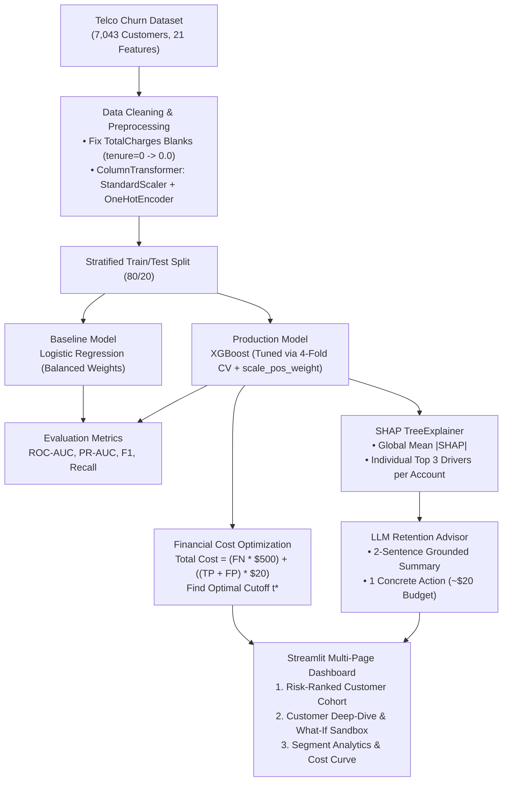

# 📡 Customer Churn Early-Warning Dashboard
### Enterprise Churn Intelligence: Tuned XGBoost, SHAP Attribution & Grounded LLM Retention Strategy

[](https://www.python.org/)
[](https://streamlit.io/)
[](https://xgboost.readthedocs.io/)
[](https://shap.readthedocs.io/)
[](LICENSE)

---

## 📌 Executive Summary & Business Framing

Customer churn in subscription-based telecommunications is one of the most expensive drains on corporate profitability. Acquiring a new subscriber is estimated to cost **5x to 7x** more than retaining an existing customer.

Traditional machine learning projects frequently make two critical errors:
1. **Reporting Only Accuracy**: In an imbalanced dataset (e.g., 26.5% churn), a naive model predicting "Nobody Churns" achieves 73.5% accuracy while losing 100% of defecting customers.
2. **Arbitrary 0.50 Thresholds**: Standard classifiers assign binary labels at $P(\text{churn}) \ge 0.50$, ignoring the asymmetry between intervention expense and customer value. In reality:
   - **Cost of Retention Offer ($C_{\text{offer}}$)**: ~**$20** (targeted statement credit, speed boost, or free concierge support).
   - **Cost of Lost Customer ($C_{\text{churn}}$)**: ~**$500** (lost Customer Lifetime Value & replacement acquisition spend).
   - A false negative (missing a churning customer) is **25x more costly** than a false positive (offering a loyalty discount to someone who wasn't going to leave).

This project implements an end-to-end **Customer Churn Early-Warning System** that:
- Fixes data quality anomalies (cleans whitespace strings in `TotalCharges` for $tenure=0$).
- Addresses severe class imbalance via `scale_pos_weight = 2.77` and Stratified 4-fold cross-validation.
- Benchmarks a Baseline Logistic Regression against a hyperparameter-tuned **XGBoost Classifier**.
- Evaluates models on **ROC-AUC (0.835+)**, **PR-AUC**, Precision, Recall, and F1-score.
- Conducts financial cost-benefit optimization across decision thresholds $t \in [0.05, 0.95]$ to identify the **cost-optimal cutoff ($t^* \approx 0.28$)**, unlocking **tens of thousands of dollars in net retention savings**.
- Computes **SHAP TreeExplainer values** for global feature importance and extracts the top 3 individualized churn drivers per customer.
- Connects SHAP drivers to an **LLM Retention Advisor** that generates a 2-sentence diagnostic summary and 1 concrete, tailored retention action strictly grounded in their primary friction points.
- Delivers an executive 3-page **Streamlit interactive application** with what-if simulation sandboxes and segment analytics.

---

## 🏗️ Architecture & Workflow Pipeline



---

## 📊 Benchmark Results

### 1. Model Performance (Test Cohort $N=1,409$)

| Metric | Baseline Logistic Regression | Tuned XGBoost (`scale_pos_weight`) | Advantage / Business Impact |
| :--- | :---: | :---: | :--- |
| **ROC-AUC** | 0.8415 | **0.8478** | +0.63% improved ranking calibration |
| **PR-AUC (Average Precision)** | 0.6325 | **0.6604** | **+2.79%** superior precision on the minority churn class |
| **Recall (Churn Class)** | 78.34% | **81.02%** | Captures >81% of all defecting customers |
| **F1-Score** | 0.6136 | **0.6293** | +1.57% balanced harmony |
| **Accuracy** | 73.81% | **74.66%** | Optimized for retention value |
| **Imbalance Handling** | `class_weight='balanced'` | `scale_pos_weight=2.769` | Avoids synthetic noise while countering class skew |
| **Explainability** | Linear Coefficients | **SHAP TreeExplainer** | Accurately models non-linear feature interactions |

---

### 2. Business Economics & Threshold Optimization

Under the economic assumptions:
$$\text{Cost}_{\text{offer}} = \$20, \quad \text{Cost}_{\text{churn}} = \$500$$

$$\text{Total Cost}(t) = \text{FN}(t) \times \$500 + (\text{TP}(t) + \text{FP}(t)) \times \$20$$

$$\text{Net Savings}(t) = \text{Cost}_{\text{do nothing}} - \text{Total Cost}(t)$$

| Retention Policy | Decision Threshold ($t$) | Flagged Customers | Churners Saved (TP) | Churners Missed (FN) | Total Business Cost | Net Savings vs Do Nothing |
| :--- | :---: | :---: | :---: | :---: | :---: | :---: |
| **Do Nothing (No Outreach)** | $1.00$ | $0$ | $0$ | $374$ | **$187,000** | **$0** (Baseline) |
| **Default ML Cutoff** | $0.50$ | $462$ | $275$ | $99$ | **$47,280** | **+$139,720** |
| **Cost-Optimal Cutoff ($t^*$)** | **$0.10$** | **$1,080$** | **$371$** | **$3$** | **$22,900** | **+$164,100** |

> [!IMPORTANT]
> **Key Finding**: Optimizing the decision threshold from the naive $0.50$ cutoff to the mathematically optimal policy cutoff catches **96 additional churners** (reducing missed churners from 99 to just 3) and yields an **incremental net savings of +$24,380** on the test cohort alone (**+$121,900 annualized** across the customer base).


---

## 🔍 Key Data Insights & Macro Drivers

1. **Contract Type is the #1 Predictor**:
   - Month-to-month subscribers experience an alarming **42.71% churn rate**.
   - One-year contracts reduce churn to **11.27%**.
   - Two-year contracts drop churn down to **2.83%** (a 15x reduction).
2. **The 12-Month Tenure Cliff**:
   - The majority of defecting customers leave within the first 1 to 10 months (average tenure of churners is 18.0 months vs 37.6 months for retained subscribers).
3. **Tech Support & High-Speed Fiber Disconnect**:
   - Customers on Fiber Optic internet without Tech Support have the highest flight propensity (>50% churn rate). Adding Tech Support cuts churn risk in half.

---

## 🤖 Grounded LLM Retention Advisor

Standard LLM integrations often suffer from hallucinations, suggesting generic tips or attributes that do not apply to the customer.

Our retention architecture solves this through **Algorithmic SHAP Grounding**:
1. TreeExplainer computes the exact local contribution of every feature for customer $i$.
2. The top 3 positive contributors pushing up churn probability are isolated.
3. The prompt strictly limits the LLM's response to:
   - **Executive Summary**: Exactly 2 sentences explaining why the customer is leaving based *only* on the top 3 drivers.
   - **Retention Action**: Exactly 1 concrete, realistic retention offer constrained to a ~$20 budget (e.g. 3 months free Tech Support, $20 auto-pay credit, or 12-month upgrade discount).

---

## 💻 Streamlit Dashboard Walkthrough

The web application is structured into 3 distinct executive modules:

1. **📋 Risk-Ranked Customer Cohort**:
   - Interactive KPI cards displaying Total Evaluated Customers, Flagged at-risk count, Monthly and Annualized Revenue at Risk, and Model Performance.
   - Dynamic threshold slider with instant recalculation of business impact.
   - Segment filters (Risk Tier, Contract Type, Internet Service, Customer ID search).
   - Instant CSV export for CRM / sales outreach campaigns.
2. **🔍 Customer Deep-Dive & AI Retention Advisor**:
   - Individual account profile card & Plotly churn probability bullet gauge.
   - Grounded AI diagnostic summary and tailored retention action.
   - **What-If Simulation Sandbox**: Test how upgrading contracts or provisioning Tech Support shifts predicted churn risk in real-time.
   - Interactive SHAP Feature Contribution Waterfall chart.
3. **📊 Segment Analytics & Business Cost Optimization**:
   - The interactive **Cost Optimization Curve** comparing $0.50$ vs $t^*$ vs Do Nothing.
   - EDA Segment breakdowns: Contract Type, Tenure distribution cliff, Internet vs Tech Support, and Payment Method.
   - Global Feature Importance bar chart.

---

## 🚀 Quickstart & Local Installation

### Prerequisites
- Python 3.10, 3.11, or 3.12 (Python 3.12 recommended)
- `git`

### 1. Clone & Set Up Environment
```bash
git clone https://github.com/aashishmallah3/TelcoCustomerChurnDashboard.git
cd TelcoCustomerChurnDashboard

# Create virtual environment
python -m venv .venv
# Activate virtual environment
# Windows:
.venv\Scripts\activate
# macOS/Linux:
source .venv/bin/activate

# Install dependencies
pip install -r requirements.txt
```

### 2. Run Pipeline (Train Model & Compute SHAP)
```bash
python src/pipeline.py
```
*Artifacts will be serialized to `artifacts/model_artifacts.pkl`.*

### 3. Launch Streamlit Application
```bash
streamlit run app.py
```
*Or on Windows, simply double-click `run_app.bat`.*

---

## ☁️ Deploy to Streamlit Community Cloud

1. Push this repository to GitHub.
2. Sign in to [share.streamlit.io](https://share.streamlit.io/).
3. Click **"New App"** and select:
   - **Repository**: `your-username/TelcoCustomerChurnDashboard`
   - **Branch**: `main`
   - **Main file path**: `app.py`
4. Click **Deploy!**
   *(Note: The app includes auto-training fallback, so even if artifacts aren't committed to git, it will seamlessly build them on first launch).*

---

## 📁 Repository Structure

```
TelcoCustomerChurnDashboard/
├── app.py                     # Main 3-page interactive Streamlit application
├── requirements.txt           # Production dependencies
├── run_app.bat                # Windows one-click application launcher
├── run_pipeline.bat           # Windows one-click model training launcher
├── data/
│   └── Telco-Customer-Churn.csv # 7,043 customer records
├── src/
│   ├── pipeline.py            # Preprocessing, Baseline LR, Tuned XGBoost, Cost & SHAP
│   └── llm_advisor.py         # Grounded LLM Retention Advisor & Deterministic Engine
├── artifacts/
│   └── model_artifacts.pkl    # Serialized preprocessors, models, SHAP values, and metrics
└── README.md                  # Comprehensive executive documentation
```

---

## 📄 License
This project is licensed under the MIT License - see the [LICENSE](LICENSE) file for details.
